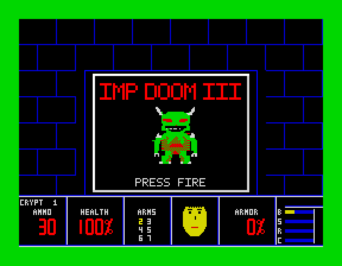

# Imp Doom

A first-person imp shooter for the **Timex Sinclair 2068** (a ray-casting 3D view in the SCLD fine colour mode), in three versions that you can play in your browser.

**Status:** three playable cartridges: **Imp Doom** (four hand-built levels, frozen), **Imp Doom II** (the same four levels remixed by a seed) and **Imp Doom III** (generated levels up to level 99, green imps, save and load on K and L; the newest and final build). They run on [TSRun](https://github.com/nchiker/TSRun), a TS2068 emulator in the browser; tested on emulators, not tried on a real TS2068.

| ▶ [**Play Imp Doom III**](https://nchiker.github.io/Imp-Doom/play.html?game=3) | 🎮 [**All three games**](https://nchiker.github.io/Imp-Doom/) | ⬇ [**imp_doom_3.dck**](cart/imp_doom_3.dck) | 🧾 [**Credits**](CREDITS.md) |
|:---:|:---:|:---:|:---:|



Imp Doom is an independent fan project. It is not affiliated with, endorsed by or sponsored by id Software or Bethesda, nor with Timex, Sinclair or Amstrad. All code, art, levels and music are original.

## Layout

| Path | What |
|---|---|
| `index.html` | landing page: the three games, how to play, controls, what a TS2068 and its fine colour mode are |
| `imp-doom-1.html`, `imp-doom-2.html`, `imp-doom-3.html` | one page per game: what is different, pictures, tune, Play |
| `play.html`, `js/play.js` | the player (`play.html?game=1`, `2` or `3`): TSRun in a canvas, pause, reset, fullscreen |
| `js/persist.js`, `js/fshost.js` | the file host for the cartridge's file calls; Imp Doom III's save (`DOOM1.SAV`) is kept in the browser's localStorage (key `impdoom:DOOM1.SAV`) |
| `cart/` | the three DOCK cartridges, `imp_doom_1.dck`, `imp_doom_2.dck`, `imp_doom_3.dck` |
| `img/`, `audio/` | screenshots and the tunes of II and III (MP3) |
| `css/site.css`, `js/site.js` | page styles and the light / dark toggle |
| `tsrun/` | TSRun, a git submodule of [nchiker/TSRun](https://github.com/nchiker/TSRun), pinned to the commit the Leap IDE uses |
| `tools/sync-assets.sh` | copies the cartridges, pictures and tunes from the game's own project and prints their md5s |
| `tools/linkcheck.mjs` | fetches every page and asset from a local server and reports anything that is not HTTP 200 |
| `tests/save-load.mjs` | headless check (Node) that K saves and L loads, through the same file host the page uses |

## Use

Play it on the site, or run it locally (no build step; the pages are static):

```sh
git clone --recurse-submodules https://github.com/nchiker/Imp-Doom.git
cd Imp-Doom
python3 -m http.server 8000       # then open http://localhost:8000/
```

The player needs WebGL 2 (it draws through TSRun's shader). Controls: <kbd>Q</kbd> / <kbd>A</kbd> forward / back, <kbd>O</kbd> / <kbd>P</kbd> turn (cursor keys work too), <kbd>Z</kbd> / <kbd>X</kbd> strafe, <kbd>SPACE</kbd> fire, <kbd>E</kbd> or <kbd>ENTER</kbd> use; in Imp Doom III <kbd>K</kbd> saves and <kbd>L</kbd> loads.

```sh
node tests/save-load.mjs           # K / L save and load (Node 18+)
node tools/linkcheck.mjs           # with the server above running
```

## Credits

TSRun is by Josef Jelínek; the page loads the stock TS2068 ROMs. See [`CREDITS.md`](CREDITS.md). MIT License, copyright (c) 2026 Charlie Day ([`LICENSE`](LICENSE)); the submodule and the ROMs keep their own terms.
